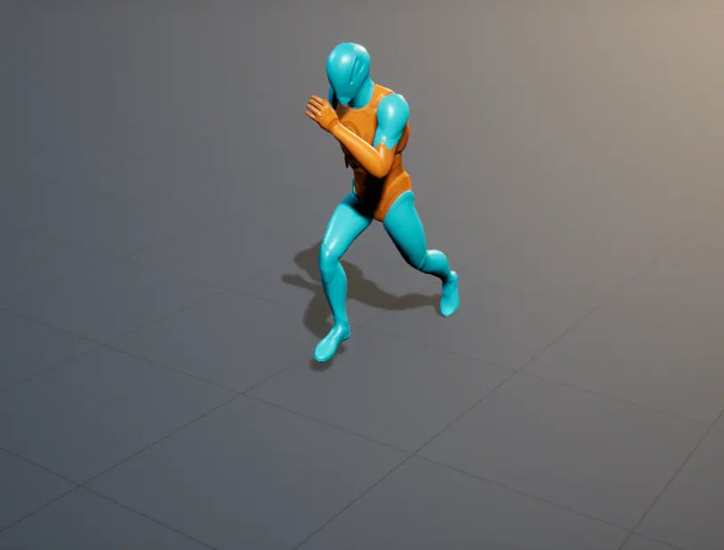

# Mesh Particleizer

Static Mesh と Skeletal Mesh を Niagara の GPU パーティクルに変換する UE5 プラグインです。粒子は分離時の表面色と動きを引き継ぎます。

**v0.1.6（ベータ）** · UE 5.8 · Windows 64 bit · DirectX 12 / SM6

## インストール

Visual Studio 2022 の「C++ によるゲーム開発」と Windows SDK が必要です。[UE の開発環境セットアップ](https://dev.epicgames.com/documentation/en-us/unreal-engine/setting-up-visual-studio-development-environment-for-cplusplus-projects-in-unreal-engine?application_version=5.8)

1. [MeshParticleizer](Plugins/MeshParticleizer) をプロジェクトの `Plugins/` にコピーします。
2. **Mesh Particleizer** と **Niagara** を有効にします。Windows の Default RHI は DirectX 12、対象シェーダー形式は SM6 に設定します。
3. プロジェクトの Development Editor ターゲットをビルドします。

## 使い方

1. Content Browser でメッシュを右クリックし、**Prepare for Particleize...** を選びます。Skeletal Mesh のマテリアルは **Used with Skeletal Mesh** を有効にします。
2. `DA_Prepared` を右クリックし、**Preview Particleize...** で確認します。
3. Actor に **Mesh Particleizer Component** を追加します。`Target` に Mesh Component、`Prepared Data` に `DA_Prepared` を指定します。
4. Blueprint の **Prepare For Particleize** に Component と Preset を渡します。`Prepared` の後、任意のタイミングで **Start Particleize** を呼びます。表示を戻す場合は `Finished` から **Restore Mesh** を呼びます。

- 灰・砂・発光・散開・地面残留の 5 種類を収録。[プリセット](Plugins/MeshParticleizer/Content/Presets)
- 複数メッシュは **Configure Targets** で登録。
- Skeletal Mesh の精密ヒット投影は、標準ボーン変形と描画 LOD 0 に対応。
- GDF 衝突を使う場合は **Generate Mesh Distance Fields** を有効化。

## ライセンス

プラグインの自作コードには MIT License を適用します。[ライセンス本文](LICENSE)

紹介映像には、Epic Games の UE5 標準マネキン Manny と標準の走行アニメーションを使用しています。
